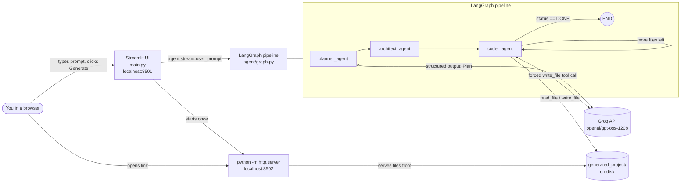

# 01 — Architecture

## The layers

How to read it:
- There is **no database**. The only storage is plain files in `generated_project/`.
- The **architect does not call the LLM**. It is ordinary Python (`agent/graph.py:32-45`); only the planner and coder talk to Groq.
- There are **two web servers**: Streamlit (8501) for *your* UI, and `http.server` (8502) for the *generated* app.

## Folder map

| Folder / file | What lives here | Analogy |
| --- | --- | --- |
| `main.py` | The Streamlit page: text box, button, status messages, preview link, file server | Reception desk |
| `agent/graph.py` | The LLM client, the three agent functions and the graph wiring | Site manager plus the workers |
| `agent/prompts.py` | Text instructions sent to the LLM | Job instructions pinned on the wall |
| `agent/states.py` | Pydantic classes describing the data passed between agents | Standard forms everyone fills in |
| `agent/tools.py` | Functions the LLM is allowed to call (read/write files) and a path-safety check | The toolbox, with a lock on the plot gate |
| `generated_project/` | Output of the last runs (currently a calculator plus a leftover todo `app.js`) | The building plot |
| `pyproject.toml` | Project name and dependency list | Shopping list of materials |
| `.python-version` | Which Python `uv` should use (`3.14`) | |
| `.gitignore` | Files Git should not track (`__pycache__`, `.venv`…) | |

## "Where would I look if…"

| Symptom | Look here first |
| --- | --- |
| The Streamlit page looks wrong or the button does nothing | `main.py:21-40` |
| Error mentioning `GROQ_API_KEY` / authentication | Your `.env` file, and `load_dotenv()` at `agent/graph.py:11` |
| "Planner did not return a valid response" | `planner_agent`, `agent/graph.py:24-28`, and the `Plan` schema in `agent/states.py:10-15` |
| The planner chose React / npm even though you didn't want it | Rules in `agent/prompts.py:5-8` |
| Files are written to the wrong place, or "Attempt to write outside project root" | `safe_path_for_project`, `agent/tools.py:10-14`, and the folder you ran the app from |
| Some files exist but others are missing | Coder loop `agent/graph.py:77-91`, and the huge debug log in your terminal |
| `GraphRecursionError: Recursion limit … reached` | Sidebar "Recursion limit" (`main.py:24`). A plan with *N* files needs *N + 3* steps |
| The generated app opens but buttons don't work | Generated files don't match each other (see `06-debugging-guide.md`, "Generated output bugs") |
| No "Open your app" link appears | `main.py:42-47`: no `index.html` was found under `generated_project/` |
| Port 8502 already in use | `SERVER_PORT` at `main.py:7` |

Try explaining this back to me in one or two sentences: *which parts of the system talk to the internet, and which only touch your disk?*
