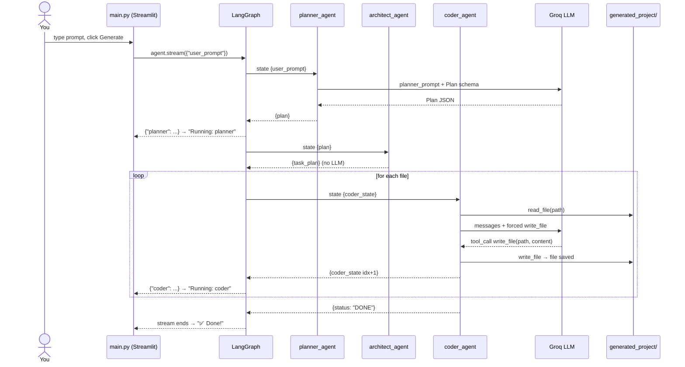
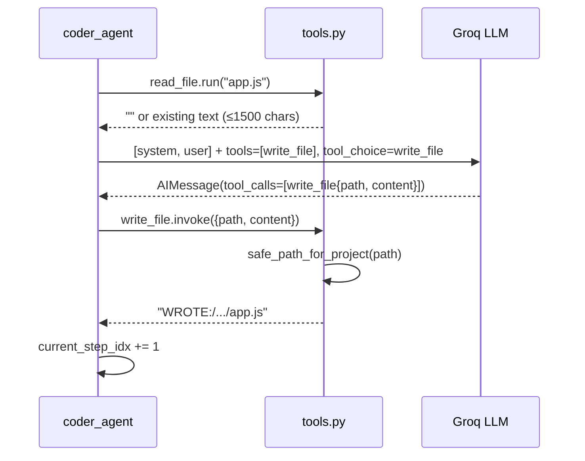
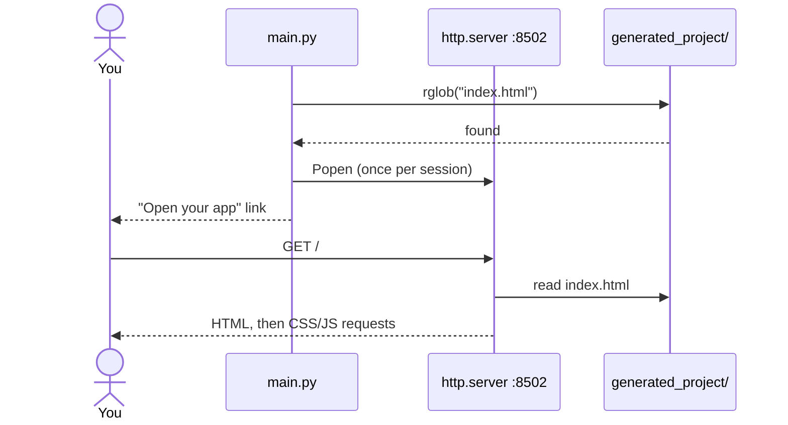

# 03 — Flows: what happens when…

Five flows, each traced through the real code. The data shape is shown at every step.

---

## Flow 1 — You run `streamlit run main.py`

1. Streamlit starts a web server on port 8501 and runs `main.py` from the top.
2. `main.py:4` does `from agent.graph import agent`, which executes all of `agent/graph.py`:
   1. `load_dotenv()` puts `GROQ_API_KEY` into the environment (`agent/graph.py:11`).
   2. `set_debug(True)` / `set_verbose(True)` turn on very detailed LangChain logging in the terminal (`agent/graph.py:13-14`).
   3. `ChatGroq(...)` creates the LLM client (`agent/graph.py:16`). No network call happens yet.
   4. `TOOL_MAP` is built: `{"read_file": <Tool>, "write_file": <Tool>, "list_files": <Tool>, "get_current_directory": <Tool>}` (`agent/graph.py:18`).
   5. The graph is built and compiled into `agent` (`agent/graph.py:97-112`).
3. Back in `main.py`: `PROJECT_ROOT = <cwd>/generated_project` (`main.py:6`).
4. Title, text area and sidebar number input are drawn (`main.py:21-24`).
5. The Generate button is drawn, disabled while the prompt is empty (`main.py:26`).
6. If an `index.html` already exists from an earlier run, the file server starts and the link is shown (`main.py:42-47`; see Flow 4).

Why step 2 matters: Python caches imports, so the graph is built **once per server process**, not on every Streamlit re-run.

---

## Flow 2 — You click **Generate** (the whole pipeline)

| # | Where | What happens | Data after this step |
| --- | --- | --- | --- |
| 1 | `main.py:26` | Click → Streamlit re-runs the script; `st.button` returns `True` | `prompt = "Build a todo app"` |
| 2 | `main.py:29` | An empty placeholder for status messages is created | |
| 3 | `main.py:30-33` | `agent.stream({"user_prompt": prompt}, {"recursion_limit": 100})` | state = `{"user_prompt": "Build a todo app"}` |
| 4 | `agent/graph.py:111` | The entry point is `planner` | |
| 5 | `agent/graph.py:21-29` | **Planner** builds the prompt text (`agent/prompts.py:1-13`) and calls the LLM with structured output | state = `{"plan": Plan(name, description, techstack, features[], files[File(path, purpose)])}` |
| 6 | `main.py:34-35` | The stream yields `{"planner": {...}}`; the UI shows "Running: **planner**" | |
| 7 | `agent/graph.py:103` | Fixed edge planner → architect | |
| 8 | `agent/graph.py:32-45` | **Architect** makes one `ImplementationTask` per file, in the planner's order. No LLM call | state = `{"task_plan": TaskPlan(implementation_steps=[{filepath, task_description}, ...], plan=Plan)}` |
| 9 | `agent/graph.py:104` | Fixed edge architect → coder | |
| 10 | `agent/graph.py:48-94` | **Coder** writes file #0 (details in Flow 3) | state = `{"coder_state": CoderState(task_plan, current_step_idx=1)}` |
| 11 | `agent/graph.py:105-109` | Conditional edge: `status` isn't `"DONE"`, so go to `coder` again | |
| 12 | … | Repeat 10–11 for every file | `current_step_idx` grows 2, 3, … N |
| 13 | `agent/graph.py:55-56` | The coder sees `current_step_idx >= len(steps)` | state = `{"coder_state": ..., "status": "DONE"}` |
| 14 | `agent/graph.py:107-108` | Conditional edge: `"DONE"` → `END` | stream ends |
| 15 | `main.py:37-38` | "✅ Done!" plus the *last* stream item shown as JSON | `step = {"coder": {"coder_state": ..., "status": "DONE"}}` |
| 16 | `main.py:42-47` | `index.html` found → server started → link shown | |

Total graph steps = 1 (planner) + 1 (architect) + N + 1 (coder) = **N + 3**.

---

## Flow 3 — The coder writes one file (zoomed in)

1. **Get or create its working state** (`agent/graph.py:50-52`). The first time, `coder_state` is missing, so it builds `CoderState(task_plan=state["task_plan"], current_step_idx=0)`.
2. **Finished?** (`agent/graph.py:54-56`) If the index has gone past the last task, return `status: "DONE"`.
3. **Pick the task** (`agent/graph.py:58`): e.g. `{filepath: "app.js", task_description: "main logic. Tech stack: HTML, CSS, JS. App: A todo app."}`.
4. **Read any existing file** (`agent/graph.py:59`). `read_file` returns `""` if the file doesn't exist (`agent/tools.py:31-32`). Content over 1500 characters is cut (`agent/graph.py:60-61`) to save tokens.
5. **Build messages** (`agent/graph.py:63-71`): one system message (`agent/prompts.py:27-33`) and one user message with the task, file path and existing content.
6. **Force `write_file`** (`agent/graph.py:75`) with `tool_choice`.
7. **Call the LLM** (`agent/graph.py:78`). The response contains `tool_calls = [{"name": "write_file", "args": {"path": "app.js", "content": "..."}, "id": "call_1"}]`.
8. **Run each tool call** (`agent/graph.py:83-85`): `TOOL_MAP["write_file"].invoke(args)` → `safe_path_for_project` checks the path → the folder is created → the file is written → returns `"WROTE:/…/generated_project/app.js"`. A `tool` message holding that result is appended.
9. **Stop once a write happened** (`agent/graph.py:86-89`).
10. **Advance** `current_step_idx += 1` and return (`agent/graph.py:93-94`).

**Viva point:** the coder only sees *its own* task description and *its own* file. It never sees the other files, so `script.js` may use element IDs that `index.html` doesn't have. Your current `generated_project/` shows exactly that (see `06-debugging-guide.md`).

---

## Flow 4 — You open the generated app

1. On every Streamlit run, `main.py:42` searches `generated_project/` (including subfolders) for an `index.html`.
2. If one exists, `start_file_server()` (`main.py:10-18`) checks `st.session_state`. The first time, it starts `python -m http.server 8502` with `cwd=generated_project` and keeps the process handle so it isn't started twice in this browser session.
3. `main.py:44-46` works out the folder: if `index.html` is in `generated_project/` the path is `/`. If it is in `generated_project/todo/`, the path is `/todo/`.
4. A markdown link `http://localhost:8502/...` is drawn (`main.py:47`).
5. You click it. Your browser asks the *second* server for `index.html`, which in turn loads its `.css` / `.js` files.

---

## Flow 5 — Something fails (e.g. missing API key)

1. `planner_agent` calls the LLM (`agent/graph.py:24`). Groq rejects the request, and the client raises an exception.
2. Nothing in `planner_agent` catches it, so it propagates out of LangGraph and out of the `for step in agent.stream(...)` loop.
3. `main.py:39-40` catches it and shows `Error: <message>` in red.
4. The full traceback appears in the **terminal** where you ran Streamlit, together with the LangChain debug output.

The same path is taken for: invalid `Plan` (`agent/graph.py:27-28`), a disallowed file path (`agent/tools.py:13`) and `GraphRecursionError`.

Now tell me the flow back in your own words: *from the click on Generate, which functions run, in what order, and what is in the state after each one?*
