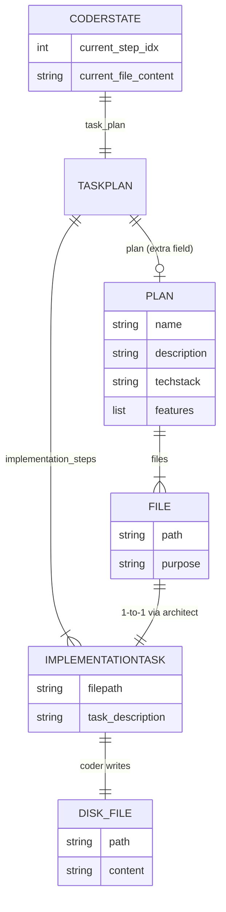

# 04 — Data

There is **no database**. Data exists in three forms:

1. **Pydantic objects in memory** (`agent/states.py`), passed between agents in LangGraph state.
2. **The LangGraph state dict**, whose contents are *replaced* after every node (see `02-concepts.md` §11).
3. **Files on disk** in `generated_project/`: the only thing that survives a run.

(The generated todo app also stores tasks in the browser's `localStorage` under the key `"todo-tasks"`, `generated_project/app.js:11, 27-44`. That belongs to the *output*, not to this project.)

---

## Models (`agent/states.py`)

### `File` (`agent/states.py:6-8`)
| Field | Type | Meaning |
| --- | --- | --- |
| `path` | `str` | Relative path of a file to create, e.g. `"index.html"` |
| `purpose` | `str` | What the file is for, e.g. `"main application logic"` |

### `Plan` (`agent/states.py:10-15`): produced by the planner
| Field | Type | Meaning |
| --- | --- | --- |
| `name` | `str` | App name |
| `description` | `str` | One-line description |
| `techstack` | `str` | e.g. `"HTML, CSS, JavaScript"` (forced by `agent/prompts.py:6`) |
| `features` | `list[str]` | Feature list. **Never used later** in the code |
| `files` | `list[File]` | Files to create, in order |

### `ImplementationTask` (`agent/states.py:17-19`): one work order
| Field | Type | Meaning |
| --- | --- | --- |
| `filepath` | `str` | Copied from `File.path` |
| `task_description` | `str` | `"{purpose}. Tech stack: {techstack}. App: {description}."` (`agent/graph.py:38`) |

### `TaskPlan` (`agent/states.py:21-23`): produced by the architect
| Field | Type | Meaning |
| --- | --- | --- |
| `implementation_steps` | `list[ImplementationTask]` | One per file |
| *(extra)* `plan` | `Plan` | Attached at `agent/graph.py:43`, allowed because of `extra="allow"`. Not read afterwards |

### `CoderState` (`agent/states.py:25-28`): the coder's progress tracker
| Field | Type | Meaning |
| --- | --- | --- |
| `task_plan` | `TaskPlan` | The full list of work orders |
| `current_step_idx` | `int` (default 0) | Which task is next |
| `current_file_content` | `Optional[str]` | **Declared but never used** |

## Relationships

## The LangGraph state over time

| After node | State dict contains |
| --- | --- |
| (input) | `{"user_prompt": str}` |
| `planner` | `{"plan": Plan}` |
| `architect` | `{"task_plan": TaskPlan}` |
| `coder` (each file) | `{"coder_state": CoderState}` |
| `coder` (final) | `{"coder_state": CoderState, "status": "DONE"}` |

## Where each piece of data is created, read, updated, deleted

| Data | Created | Read | Updated | Deleted |
| --- | --- | --- | --- | --- |
| `user_prompt` | `main.py:31` | `agent/graph.py:23` | – | dropped from state after planner |
| `Plan` | `agent/graph.py:24-26` (by the LLM, parsed by LangChain) | `agent/graph.py:34-40` | – | – |
| `TaskPlan` | `agent/graph.py:42` | `agent/graph.py:52, 54` | `agent/graph.py:43` (adds `.plan`) | – |
| `CoderState` | `agent/graph.py:52` | `agent/graph.py:50, 54-58` | `agent/graph.py:93` (`current_step_idx += 1`) | – |
| Files on disk | `agent/tools.py:20-24` (`write_file`) | `agent/tools.py:28-34` (`read_file`); `main.py:42-44`; `http.server` | overwritten by `write_file` (mode `"w"`) | **never**: old files from earlier runs stay |
| `server_proc` | `main.py:12-18` | `main.py:11` | – | never stopped explicitly |

That last "Deleted: never" column explains why `generated_project/` currently has a todo-app `app.js` next to a calculator `index.html`/`script.js`/`style.css`: two runs have mixed together.

Try explaining this back to me in one or two sentences: *what is `current_step_idx`, who changes it, and how does it make the coder stop?*
